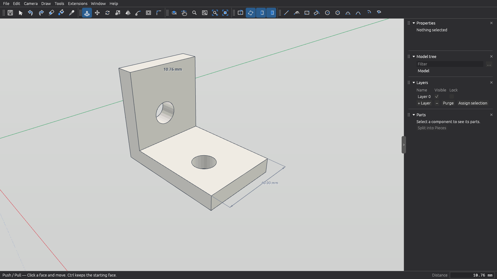

# Xtrude CAD

**Precise technical 3D modeling for 3D printing** — robot parts, brackets,
enclosures, PCB mounts, servo horns — with *push/pull* modeling, as a native
Rust application. Website: <https://xtrudecad.org>.



## Origin and attribution

Xtrude CAD is a push/pull modeller for **precise technical 3D
modelling of parts that will be 3D-printed** (robot parts, brackets,
enclosures, PCB mounts). It is a project derived from
[IngeTrazo](https://github.com/ingelibre/ingetrazo) by **Marco Sumari
Tellez** and the IngeTrazo contributors (see [AUTHORS](AUTHORS)):
it started from IngeTrazo's Python code, stripped of everything
architecture/BIM/GIS/rendering-related, and was rewritten in **native
Rust** for speed and robustness. It is licensed under
[GPL-3.0-or-later](LICENSE).

This is a **modified version** of IngeTrazo (GPL-3.0 §5a), changed in
2026-10: the architecture, BIM/IFC, geo-referencing, sheet, rendering,
texture, translation and packaging features were removed, millimetre
documents became the default, and the Python/PySide6 application was
rewritten in Rust (wgpu + egui).

Xtrude CAD keeps IngeTrazo's `.igz` document format: IngeTrazo documents
open directly, and documents written by Xtrude CAD open in IngeTrazo.

## File formats

- **Documents:** `.igz`, open and save.
- **Import:** STEP (`.step`, `.stp`; AP203, AP214, AP242), STL, Wavefront
  OBJ, glTF/GLB, COLLADA (`.dae`), DXF and `.skp`.
- **Export:** STL (millimetres), Wavefront OBJ, glTF/GLB, COLLADA and
  images.

A STEP file describes exact surfaces; Xtrude CAD models with flat faces,
so it tessellates the file on import (0.01 mm chord tolerance by
default). Each part becomes a group with its name, placement and
colours. It is a faceted copy to measure, snap to and model around, and
a solid you can print or combine when the part is closed. STEP is read
with [OpenCascade](https://dev.opencascade.org) in a separate helper
program, `xtrude-step`. `xtrude-convert part.step part.stl` converts
from the command line.

## Extensions

Xtrude CAD runs extensions written in Lua: commands in the Extensions
menu that build or edit geometry, such as parametric gears and boxes. Each
run is one undo step. See [docs/extensions.md](docs/extensions.md) for
the folder layout, the manifest and the API.

## Install

Linux, x86_64. Each release on the
[releases page](https://github.com/xtrudecad/xtrude-cad/releases) has a
portable tarball, `xtrude-cad-X.Y.Z-x86_64-linux.tar.gz`, that runs on
any distribution with glibc 2.28 or newer (RHEL/AlmaLinux 8, Debian 10,
Ubuntu 18.10 and later). Download it with `SHA256SUMS`, check it, unpack
it and install it for your user (into `~/.local`; `PREFIX=/usr/local`
as root for every user):

```bash
sha256sum -c --ignore-missing SHA256SUMS
# optional: check that GitHub Actions built it from this repository
gh attestation verify xtrude-cad-X.Y.Z-x86_64-linux.tar.gz --repo xtrudecad/xtrude-cad
tar -xzf xtrude-cad-X.Y.Z-x86_64-linux.tar.gz
cd xtrude-cad-X.Y.Z-x86_64-linux
./install.sh                # Xtrude CAD appears in the applications menu
./install.sh --uninstall    # removes it again (run from the same folder)
```

The tarball includes the STEP helper, so STEP import works out of the
box.

Flathub: not published yet.

## Build and run

Requires a Rust toolchain (1.85 or newer) and a GPU driver with Vulkan,
Metal, DX12 or OpenGL ES 3 support. Linux is the primary target.

```bash
cargo run --release -p xtrude-app                 # launch
cargo run --release -p xtrude-app -- part.igz     # open a document
cargo run --release -p xtrude-app -- --check      # self-check (prints OK)
```

STEP import needs the helper built with OpenCascade, which compiles from
source (CMake and a C++17 compiler; about 17 minutes the first time).
Without it, a plain build makes a stub and the import says STEP support
is not installed:

```bash
CMAKE_POLICY_VERSION_MINIMUM=3.5 cargo build --release -p xtrude-step --features occt
```

Checks (what CI runs on every push and pull request):

```bash
scripts/check.sh      # fmt, clippy -D warnings, tests, cargo-deny, SPDX headers, release scripts, reuse lint
```

CI also validates the desktop integration files in `packaging/linux/`
(`desktop-file-validate`, `xmllint`, `appstreamcli validate`), and builds
the STEP helper with OpenCascade to run the STEP tests against it.
Making a release is described in [RELEASING.md](RELEASING.md).

## AI assistance

Parts of this codebase, including the Rust rewrite of the Python code, were written
with the help of Claude (Anthropic). Every change is reviewed and signed off
by a human maintainer, who is responsible for it. AI-assisted commits carry
a `Co-Authored-By: Claude` trailer.

## Community and contact

- **Bugs and feature requests:** [issues](https://github.com/xtrudecad/xtrude-cad/issues).
- **Questions, ideas, parts you made:** [discussions](https://github.com/xtrudecad/xtrude-cad/discussions).
- **Security problems:** a private report, never a public issue; see
  [SECURITY.md](SECURITY.md).
- **Code of conduct reports:** conduct@xtrudecad.org; see
  [CODE_OF_CONDUCT.md](CODE_OF_CONDUCT.md).
- **Anything else that cannot be public** (press, licensing, legal):
  hello@xtrudecad.org.

Questions asked in public get answers everyone can find, so please use
email only for what has to stay private.

## Contributing

See [CONTRIBUTING.md](CONTRIBUTING.md). Everyone taking part in the
project follows the [code of conduct](CODE_OF_CONDUCT.md).

## License

[GPL-3.0-or-later](LICENSE), like IngeTrazo. You are free to use, study,
modify and redistribute Xtrude CAD, provided derivative works stay under the
same license. The project follows the [REUSE](https://reuse.software)
specification: every source file carries an SPDX header, data files are
annotated in [REUSE.toml](REUSE.toml), the licence texts are in
[LICENSES/](LICENSES), and copyright holders are listed in [AUTHORS](AUTHORS).
The licence is declared once in the workspace `Cargo.toml`, and `deny.toml`
keeps every dependency GPL-3.0-compatible.

---

*Xtrude CAD, like IngeTrazo, is an independent project, not affiliated with any
other software vendor; the file formats it reads belong to their respective
owners.*
